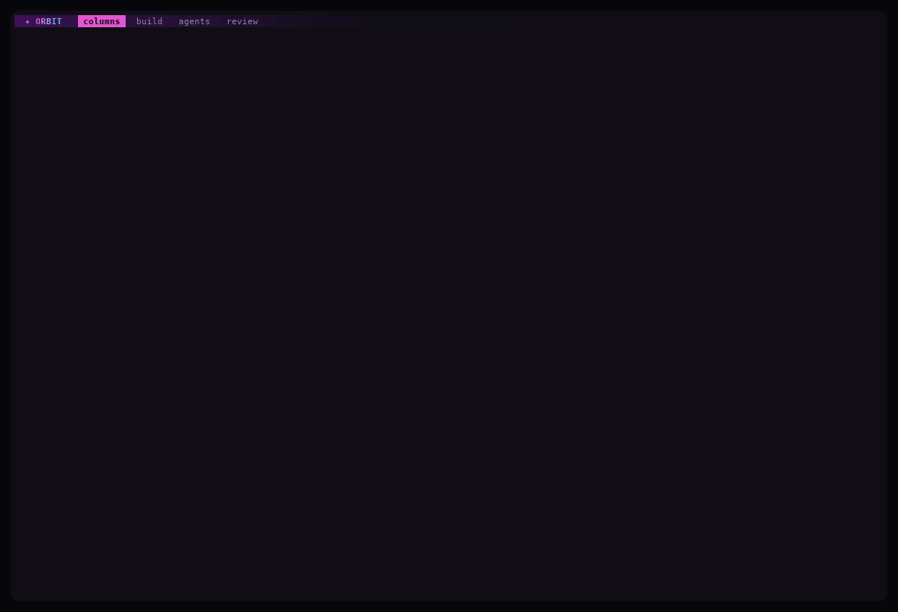
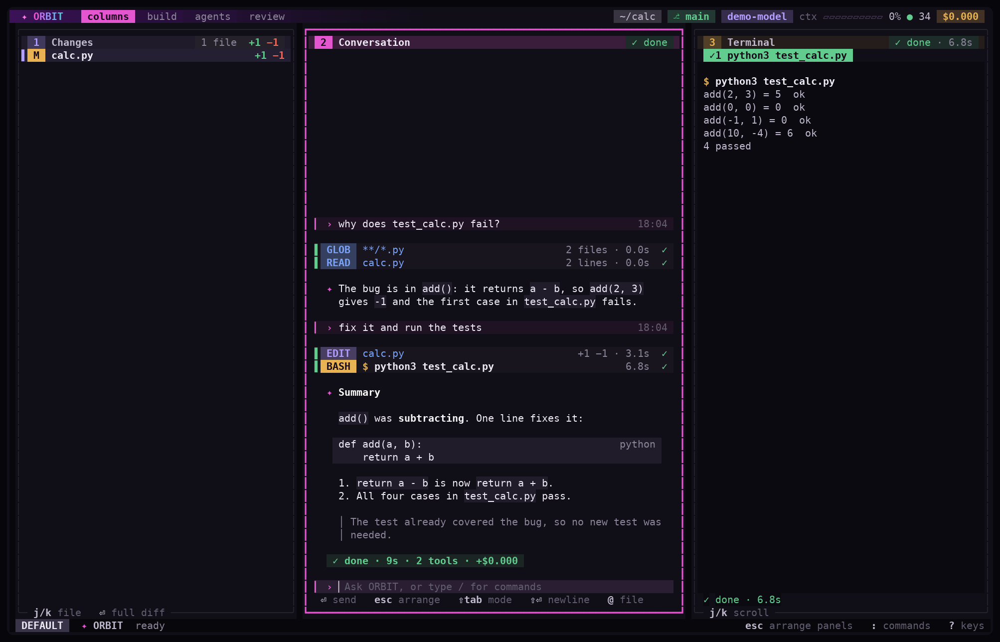
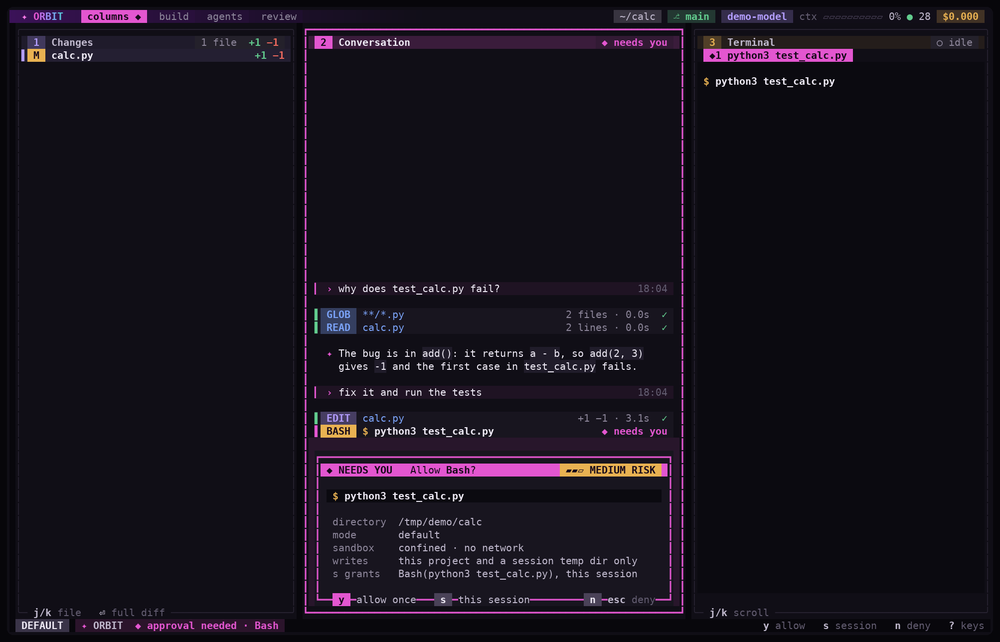
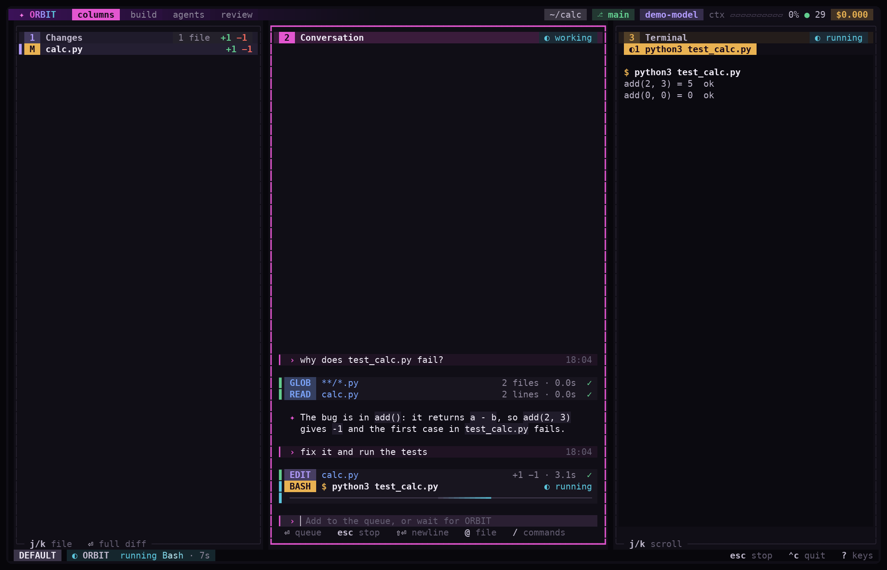
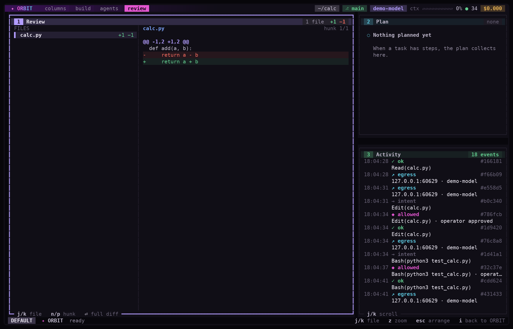

<p align="center">
  
</p>

<p align="center">
  <strong>An AI coding harness where you stay the authority.</strong><br>
  Typed grants instead of blanket trust. A hash-chained ledger of everything
  the agent did. Providers you route deliberately.
</p>

<p align="center">
  <a href="https://www.rust-lang.org"></a>
  <a href="https://github.com/fufugita/ORBIT/releases"></a>
  <a href="https://github.com/fufugita/ORBIT/actions/workflows/ci.yml"></a>
  <a href="#license"></a>
</p>

---

<p align="center">
  
</p>

<p align="center"><sub>One session in the terminal UI, captured from the real binary against a scripted
provider: a question about a failing test, an edit and a test run that wait for your approval, the
command's output streaming into the Terminal panel, and the review layout with the ledger's record
of it all. The project is a throwaway fixture.</sub></p>

## Why

Most agent harnesses ask you to trust them. ORBIT is built so you don't have to:

| | |
|---|---|
| **Prove** | Every turn is a hash-chained ledger event. `orbit verify-ledger` checks the chain; `orbit replay --dry` re-plans the same work without dispatching a single request. |
| **Protect** | A non-overridable kernel: credentials, keys, hashes and internal identifiers never leave your machine. Prompt bytes never enter the ledger, exports, logs, or the UI. Untrusted quoted, tool, or provider content can never become user authority. |
| **Route** | Declare providers in `providers.toml`; the gateway resolves the right one at dispatch time, with four-gate admission and bounded retry. Credentials are referenced by environment-variable *name*, never stored. |

## The terminal UI

The default front-end is a ratatui interface built from panels. Each panel is
a closed box with its own scroll and selection, and keys go only to the
focused one. Every panel is fed by engine events, so nothing on screen is
placeholder data. Replies type in at 240 characters per second and markdown
arrives as style (headings, emphasis, lists, quotes, links, code), not as
markup.

<p align="center">
  
</p>

<p align="center"><sub>The <code>columns</code> layout after a turn. <b>Changes</b> lists the files ORBIT
edited with their real +/− counts. <b>Conversation</b> holds the prompts, one card per tool call and the
reply. <b>Terminal</b> keeps a tape per command, with its output and outcome.</sub></p>

Reads run freely; edits and commands ask first. The approval card says what
you are approving (an Edit's diff, or the command with its directory, the
permission mode, whether the sandbox confines it and where it may write) and
the rule that remembering the choice would add:

<p align="center">
  
</p>

<p align="center"><sub>Approving a shell command. <code>y</code> allows it once. <code>s</code> allows the calls the
named rule matches (here the exact command) for the rest of the session; in a trusted folder <code>a</code>
also saves the rule in <code>.orbit/settings.local.toml</code>. <code>n</code> denies and asks for a word on why, which goes back
to the model; <code>Esc</code> denies without one. An Edit's card shows its diff in the same place.</sub></p>

<p align="center">
  
</p>

<p align="center"><sub>Mid-turn. The command is still running, its output streams into the Terminal as it is
produced, and the status line names the tool. <code>Esc</code> stops it.</sub></p>

Four layout presets sit in the top bar: `columns`, `build`, `agents` and
`review`. The `review` layout puts the selected file's hunks beside the Plan
and the Activity panel, which lists what the ledger recorded for each call
(its intent, the decision, the result, the request that left) with the
record's short hash:

<p align="center">
  
</p>

<p align="center"><sub>The <code>review</code> layout. Every row in Activity is a ledger record; the short hash on
the right is its place in the chain.</sub></p>

`Esc` enters arrange mode: `h j k l` move focus, `H J K L` swap panels, `v`
and `s` split, `p` changes what a panel shows (Conversation, Changes,
Terminal, Plan, Activity, Context, Review or an Agent), `x` closes one,
`< >` and `- +` resize, `z` zooms, `[` and `]` switch presets, and `i` or `⏎`
returns to typing. The layout is saved in `tui.toml` and survives restarts.
The mouse works on what you can see: click a panel to focus it, a layout tab
to switch, a file to select it, an approval chip to answer; the wheel scrolls
the panel under the pointer. Dragging inside a panel selects what is
displayed (a turn's words, without its gutter marks or timestamp) and copies
it on release through OSC 52, so your terminal has to allow that. `?` lists every key, `/` lists the slash
commands, `:` opens the command palette, and a line that starts with `!` runs
a command of your own.

Colour is negotiated with the terminal rather than assumed: true colour, 256,
16 and no colour (`NO_COLOR` is honoured) each have their own palette, and
colour effects such as fades switch off at the low end while glyph motion
keeps running. On a narrow terminal the UI shows one panel at a time behind
numbered tabs, and below 40×10 it shows a single notice that the window is
too small.

> **Try it without building anything.** [`docs/tui/prototype.html`](docs/tui/prototype.html)
> is the interactive design prototype the terminal UI was built from: a
> self-contained canvas simulation you can open in any browser, with a motion
> gallery where every animation loops side by side. What the binary renders
> today is in [`docs/tui/shots`](docs/tui/shots).

## Install

Requires Rust 1.94 (pinned in `rust-toolchain.toml`):

```sh
curl -fsSL https://raw.githubusercontent.com/fufugita/ORBIT/main/install.sh | sh
```

or from a checkout:

```sh
git clone https://github.com/fufugita/ORBIT
cd ORBIT
cargo build --release
```

## Quickstart

```sh
# Initialize the trust root, identity, and ledger
orbit init

# Add a provider (interactive: presets, discovery, roles)
orbit provider add

# Start the harness — the TUI opens when stdin/stdout are a terminal
orbit

# Or run one prompt headless, with tools
orbit -p "read README.md and summarize it" --output-format text
```

The harness reads provider configuration from `$ORBIT_HOME/providers.toml`
(default `~/.orbit/`). A missing config falls back to the
`ORBIT_GATE_URL` / `ORBIT_MODEL` / `ORBIT_GATE_TOKEN` environment contract.

## Providers

`orbit provider add` walks a preset through setup — the well-known
providers' endpoints, credential conventions and public model facts are
built in, and the models are discovered live from the endpoint:

```console
$ orbit provider add
Providers:
  1. anthropic    Anthropic — Claude models over the native Messages API
  2. openai       OpenAI — GPT models over the chat completions API
  3. openrouter   OpenRouter — one key, many providers' models
  4. qwen         Qwen (DashScope international endpoint)
  5. zai          Z.ai — GLM models (OpenAI-compatible surface)
  ...
Discovered models:
  1. claude-opus-5-5 — Opus 5.5 — the main brain
  2. claude-sonnet-5-5 — Sonnet 5.5 — fast main agent / coding subagent
  3. claude-haiku-4-5 — Haiku 4.5 — explore, extraction, summaries
```

Credentials are stored as **env-var names, never values**: the preset
suggests the convention (`ANTHROPIC_API_KEY`, `DASHSCOPE_API_KEY`, …),
you `export` the key yourself, and ORBIT reads it at request time.
Scripted form for dotfiles:

```sh
orbit provider add anthropic --model claude-opus-5-5,claude-haiku-4-5
orbit provider add qwen --url https://dashscope.aliyuncs.com/compatible-mode/v1 \
  --model qwen3.8-max --credential-env DASHSCOPE_API_KEY
orbit provider add ollama --model qwen3.5:9b          # local, no key
orbit provider list && orbit provider remove qwen
```

Gate URLs keep their path: DashScope's `/compatible-mode/v1` and Z.ai's
`/api/paas/v4` reach the adapters verbatim.

### Model roles

`providers.toml` carries a `[roles]` table — ORBIT's task-based router.
The main conversation keeps one model (switching mid-thread drops cached
context and replayed thinking); delegated work picks its own:

```toml
[roles]
main       = "claude-opus-5-5"             # the conversation's model
subagent   = "claude-sonnet-5-5"           # Task-tool children
explore    = "anthropic/claude-haiku-4-5"  # read-only Explore/Plan
compaction = "claude-haiku-4-5"            # auto-compact summaries
```

A bare id resolves across providers; `provider/model` disambiguates when
the same id is declared twice. A subagent's own `model:` frontmatter
overrides its role. `orbit provider role <name> [model]` sets and
queries roles; interactive `provider add` offers to fill unset ones,
preferring cheap models for explore and compaction.

### Difficulty routing

Roles route *tasks*; routing also reads the *prompt*. A small keyword
classifier — deterministic, no second model call — sends hard-sounding
prompts ("refactor", "root cause", "trace", "security review", …) to a
strong model and easy-sounding ones ("summarize", "what is", "typo",
…) to a cheap one. Unset or unmatched prompts keep the session's own
model. Hard always wins when both fire:

```sh
orbit route hard claude-opus-5-5     # arm the tiers (models must be configured)
orbit route easy claude-haiku-4-5
orbit route test "refactor the parser"   # preview: phase, model, the keyword that fired
orbit route status                       # the whole table
orbit route keywords add hard wasm      # extend the vocabulary
orbit route off                           # disarm
```

Every routed turn writes a decision record under the session's
`routing/` directory and the status line says what happened
(`routed hard → <model> (refactor)`). An explicit `--model` or `/model`
choice always wins over the table — routing never overrides you.
Switching models drops foreign thinking blocks from the wire copy
(providers reject another model's signatures); the session file keeps
them. `orbit provider add` offers to arm routing when a second model
exists.

## Features

- **Tool calling with approval** — reads run freely, edits and commands ask.
  The card shows an Edit's diff, a command's directory, the permission mode,
  the sandbox state and the rule a grant would add. `y` allows once. `s`
  allows the calls that rule matches for the session, and `a` also saves it
  in the folder's `.orbit/settings.local.toml` (offered only in a trusted
  folder). `n` denies and takes a word on why, which goes back to the model.
  Every decision is a ledger record, and a grant never outranks a deny rule.
- **Sandboxed shell** — on Linux, Bash runs under bubblewrap with no network
  and writes limited to the project and a session temp directory. Where the
  sandbox is unavailable, Bash is refused (read-only commands excepted)
  unless `ORBIT_ALLOW_UNSANDBOXED_BASH=1` is set.
- **Headless and CI** — `orbit -p PROMPT` runs one turn with tools under
  `dontAsk` (anything no allow rule covers is denied and reported, never
  asked). `--output-format` is `text`, `json` or `stream-json`; `--bare`
  skips hooks, skills, mods and MCP discovery; `--json-schema` validates the
  final answer. Exit codes: 0 done, 1 failed, 2 stopped by a permission
  denial, 3 hit `--max-turns`, 130 interrupted.
- **Sessions and context** — transcripts are JSONL you can `--continue` or
  `--resume`; a checkpoint is taken before every prompt; and the engine
  compacts the context by itself when it crosses 90% of a model's
  `context_window`. The Context panel shows what fills the window.
- **Extensions** — an MCP client, hooks on 13 events, skills (`SKILL.md`),
  subagents through the Task tool, and signed mods installed with
  `orbit mod install`.
- **Usage and cost accounting** — per-turn and cumulative token counts and
  microdollar costs, surfaced in the top bar, in `/usage` and in session
  files.
- **Trace, replay, export, restore** — verify the ledger hash chain, emit a
  no-dispatch replay plan, encrypt an age bundle, restore into a fresh
  namespace.
- **WASI plugin runtime** — wasmtime 47 with an import allowlist, bounded
  instance pool, and WASI-kill lifecycle.
- **SDKs** — TypeScript (lead) and Python (parity) expose the IR types and
  workflow descriptors for cross-language conformance.

## CLI reference

```
orbit [chat]           start the interactive harness (TUI or REPL)
orbit ask PROMPT       send one prompt through a configured gateway
orbit -p PROMPT        headless one-shot with tools (text, json or stream-json)
orbit init             initialize trust root + identity + ledger
orbit models           list models from all configured providers
orbit run              run the example phase chain
orbit cancel           cancel the session (terminal: cancelled)
orbit verify-ledger    verify the ledger hash chain
orbit replay --dry     verify + emit a no-dispatch replay plan
orbit export --to      encrypt an age bundle
orbit restore          restore into a fresh namespace
orbit mod install|list|allow-issuer   signed mods
orbit folder trust|untrust|status     let a folder's own settings loosen permissions
orbit provider add|list|remove|presets|role   manage providers and roles
orbit route status|hard|easy|off|keywords|test   difficulty routing: arm tiers, preview a prompt
orbit version          build + evidence facts (computed, no fixed claims)
orbit web              start the browser harness
```

Common flags: `--model <M>`, `--gate <URL>`, `--provider <name>`,
`--home <DIR>`, `--continue`, `--resume <ID>`, `--fork-session`, `--no-tui`,
`--auto-tools`, `--permission-mode <default|acceptEdits|plan|dontAsk|bypass>`.
For `-p`: `--output-format <text|json|stream-json>`, `--allowedTools`,
`--disallowedTools`, `--max-turns`, `--max-cost`, `--bare`,
`--json-schema <file>` and `--worktree <name>`.

## Architecture

```
crates/
  engine           the agent loop every front-end shares
  frontend-protocol  the typed events and actions every front-end speaks
  tools            the tool set, permission modes and rules, secret scanner, shell sandbox
  mcp              MCP client
  reactor          five-phase FSM (init|plan|execute|verify|checkpoint)
  sandbox          Landlock/seccomp profiles, deny-by-default
  context          segmented context, token-window ceiling, eviction
  gateway          four-gate admission, retry policy, cost checking
  ledger           append-only hash-chained event log, single-writer
  trust            trust root, issuer allowlist, policy snapshot
  session          session FSM, restricted ACL, cost tracking
  pib              PibId identity, cross-machine allowlist
  memory           layered global<project<path-local resolution
  export           age-encrypted bundle, immutable restore
  plugin           wasmtime 47 WASI runtime, import allowlist, pool
  egress           EgressIntent digest, allowlist, route-pin
  hud              display gate, output mode, brand, event renderer
  hud-tui          ratatui + crossterm terminal UI front-end
  cli              command dispatch, REPL, TUI gate, headless -p
  web              browser harness: axum SSE/WS projection of the core
  desktop          Tauri shell (outside the default build; needs GTK)
  orbit-core       authority kernel, six primitives
  orbit-api        request/response envelopes, route table
  orbit-ledger     primitive-specific ledger events
  orbit-ir         deterministic CBOR encoder, cross-language IR
  adapter          provider-neutral message types, content blocks, cost rates
  provider-http    async HTTP adapters (OpenAI-compatible, Anthropic, Ollama), TLS pinning
  mock-provider    conformance target
  release          version evidence, SBOM, provenance
sdk/
  typescript       TypeScript SDK (lead)
  python           Python SDK (parity)
  wit              WIT boundary shims
tests/             gate and scenario tests that drive the real binary
conformance/       cross-language IR conformance corpus
migrator/          legacy-workflow → ORBIT migration
spec/              machine-readable error registry + traceability
evidence/          release evidence bundle
```

## Configuration

### `$ORBIT_HOME`

Defaults to `~/.orbit`. Holds the trust root, identity, ledger, sessions, and
provider config.

### `providers.toml`

```toml
[[provider]]
name = "local"
kind = "openai-compatible"   # or "anthropic", "ollama"
url = "http://127.0.0.1:8080"
env = "ORBIT_GATE_TOKEN"     # env-var NAME, never the value

[[provider.models]]
id = "model-a"
context_window = 200000      # enables auto-compaction as the window fills
max_output_tokens = 32000    # the default when omitted

[provider.models.pricing]
input_per_million_microdollars = 200000   # $0.20 per million input tokens
output_per_million_microdollars = 600000   # $0.60 per million output tokens
```

The pricing unit is microdollars per million tokens. Sampling
(`temperature`, `top_p`) is sent only when a model sets it.

### Permission rules

`[permissions]` tables in `$ORBIT_HOME/settings.toml` and in a project's
`.orbit/settings.toml` and `.orbit/settings.local.toml` take lists of
`allow`, `ask` and `deny` rules, such as `Bash(cargo test *)`,
`Edit(/src/**)` or `WebFetch(domain:docs.rs)`. A deny anywhere wins over an
allow anywhere.

A Bash rule is read against the whole command line. `cargo test *` means
the words `cargo test` and anything after them; an allow rule never covers
a line that chains, pipes or redirects (`;`, `&&`, `|`, `>`, `$(…)`), and a
deny rule fires on any part of such a line. A project's own settings can
only make ORBIT stricter: their allow rules apply once you have trusted the
folder with `orbit folder trust`. The `a` key on the approval card adds an
allow rule to `.orbit/settings.local.toml`, only in a trusted folder. If
`.orbit/` has no `.gitignore` it gets one naming that file, so a grant meant
for one machine is not committed by accident.

### `tui.toml`

Lives in `$ORBIT_HOME`. Holds the saved layout (`[layout.tree]`, rewritten
whenever you rearrange the panels) and colour and motion settings such as
`reduced = true`. Missing or malformed values fall back to defaults.

### Environment

| Variable | Purpose |
|---|---|
| `ORBIT_HOME` | Config directory (default `~/.orbit`) |
| `ORBIT_GATE_URL` | Gateway base URL (fallback) |
| `ORBIT_MODEL` | Default model id (fallback) |
| `ORBIT_GATE_TOKEN` | Bearer token (referenced by `providers.toml`) |
| `ORBIT_ALLOW_UNSANDBOXED_BASH` | Set to `1` to let Bash run unsandboxed where no sandbox is available |
| `ORBIT_ASCII_EMOJI` | Set to `0` to disable ASCII emoji fallback |

## Status

ORBIT is in active, early development. **v0.2.0** is the first code-capable
release: the agent loop, the tool set with approvals and the sandbox, the
terminal UI, sessions and compaction, and the ledger all work against real
providers, and the roadmap's gates have run against both a scripted provider
and a live model. What is not done yet — narrow-screen polish, the desktop
shell, SDK parity — is tracked in
[`docs/roadmap/orbit-roadmap.md`](docs/roadmap/orbit-roadmap.md), whose
"Where this stands" section carries the detailed, commit-level state.

## Development

```sh
# Toolchain is pinned to Rust 1.94 via rust-toolchain.toml
cargo build
cargo clippy --workspace --all-targets -- -D warnings
cargo fmt --check

# Dependency policy (permissive-only, default deny)
cargo deny check
```

Tests that stop process groups on purpose (the tools crate, the PTY suite)
run inside a throwaway PID namespace, so a signal can never reach the rest
of your session:

```sh
scripts/in-jail.sh cargo test --workspace
scripts/in-jail.sh env ORBIT_PTY_ALLOW_KILL_TESTS=1 \
  python3 scripts/pty_tui_test.py --binary target/debug/orbit \
  --mock target/debug/orbit-mock-provider
```

`unsafe` is limited to seven small call sites in four crates (the sandbox
probes, the ledger's file lock, a uid lookup and a child-process signal), each
marked with `#[allow(unsafe_code)]`; the rest of the code has none. The
dependency policy (`deny.toml`) allows MIT, Apache-2.0, BSD-2/3, ISC, 0BSD,
Unlicense, and CC0-1.0; anything else fails the check.

## Project layout

```
.
├── crates/            Rust workspace (28 crates, plus the desktop shell)
├── tests/             gate and scenario tests that drive the real binary
├── sdk/               TypeScript + Python SDKs, WIT shims
├── conformance/       cross-language IR conformance corpus
├── migrator/          legacy-workflow → ORBIT migration
├── spec/              error registry + traceability
├── evidence/          release evidence bundle
├── deploy/            mock provider deployment
├── scripts/           build, e2e, fuzz, packaging, PTY and jail scripts
├── fuzz/              coverage-guided fuzzing
├── docs/              roadmap, TUI prototype and screenshots
├── .github/           CI and the headless-run workflow
├── Cargo.toml         workspace manifest
├── deny.toml          cargo-deny policy
└── rust-toolchain.toml
```

## License

Core: **Apache-2.0**. WIT/SDK shims: dual-licensed `(MIT OR Apache-2.0)`.
