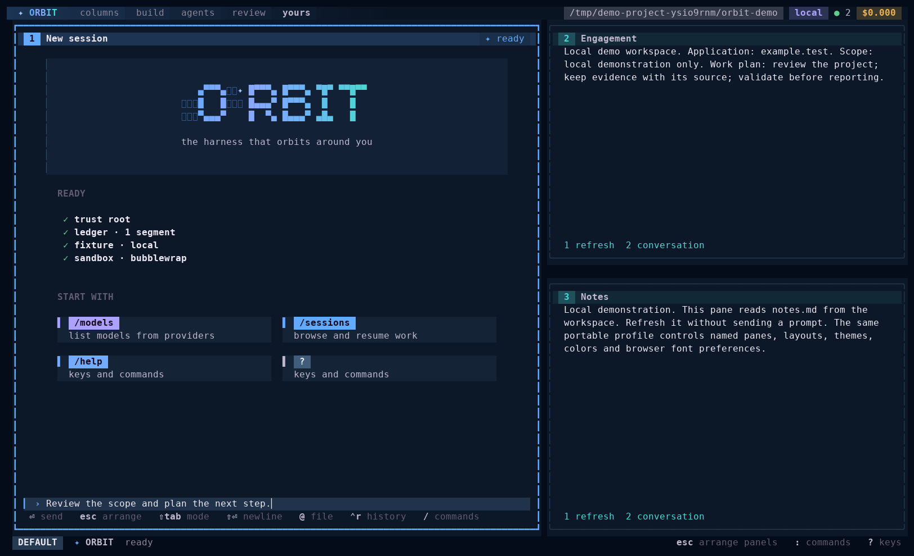
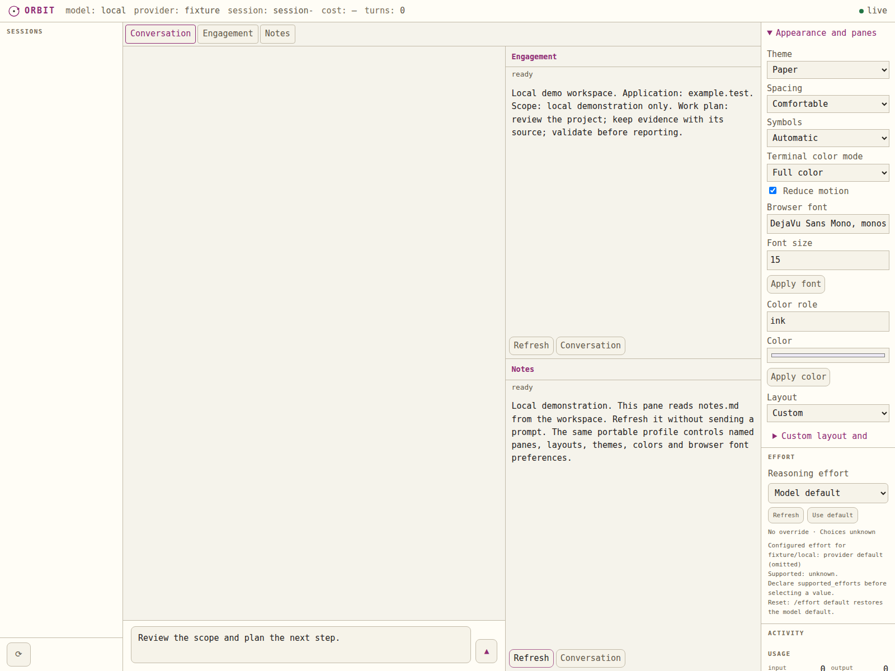

<p align="center">
  
</p>

<p align="center">
  <strong>A configurable workspace for coding and pentest work.</strong><br>
  Your terminal or browser. Your models, tools, and layout.
</p>

<p align="center">
  <a href="#install">Install</a> · <a href="#get-started">Get started</a> ·
  <a href="docs/customization.md">Customize</a> ·
  <a href="#documentation">Documentation</a>
</p>

ORBIT brings conversation, file changes, command output, and delegated work into
one open-source workspace. Connect cloud providers or local models, configure task
routing and permissions, then work in your terminal, browser, or a headless command.

<p align="center">
  
</p>

<p align="center"><sub>Captured from the real terminal interface with a scripted provider and a disposable project.</sub></p>

## What you can do

| | |
|---|---|
| **Build and investigate** | Read files, edit code, run commands, inspect diffs, and follow streamed tool output. |
| **Choose your models** | Use Anthropic, OpenAI-compatible, and Ollama adapters; configure models and roles explicitly. |
| **Route by task** | Map task phases and difficulty to different models, preview a decision, or pin your own selection. |
| **Delegate and return** | Name agents, resume their saved conversations, and inspect the model and effort each one uses. |
| **Make it yours** | Change themes, colors, layouts, tabs, and panes; set browser fonts and share portable profiles. |
| **Connect your tools** | Configure local MCP servers, language diagnostics, skills, hooks, and instruction mods. |
| **Organize pentests** | Start with scope, notes, evidence, findings, report templates, and an engagement layout. |

## Install

### Homebrew on Linux

Build the current main branch and install both `orbit` and `orbit-web`:

```sh
brew tap fufugita/orbit https://github.com/fufugita/ORBIT.git
brew install --HEAD fufugita/orbit/orbit
```

The formula uses Homebrew's Rust build dependency. `--HEAD` tracks main.

### npm on Linux

The `next` preview packages are prepared; registry publication is pending. After publication:

```sh
npm install --global --include=optional @fufugita/orbit@next
```

Requires **Node.js 22.15+ (22.x), or 23.11+**, Linux **x64 or arm64**, and **glibc 2.35+**.
The optional platform package contains both executables. Installation needs no
Rust compiler or lifecycle download script. See [package distribution](docs/setup.md#package-distribution)
for availability, local package installation, and uninstall instructions.

### From source

Install Rust through [rustup](https://rustup.rs/), then build with the pinned Rust 1.99 toolchain:

```sh
git clone https://github.com/fufugita/ORBIT.git
cd ORBIT
bash install.sh --method source --source . --version 0.2.0 --dir "$HOME/.local/bin"
```

Add the installation directory to `PATH`. The managed installer switches both
executables together and preserves your configuration. See [setup](docs/setup.md)
for bundle installation, upgrades, prerequisites, and platform limits.

## Get started

Guided setup initializes ORBIT and asks for your endpoint, model IDs, and credential variable **name**:

```sh
orbit setup --guided
```

Export the credential in your shell, then check your configuration and open ORBIT:

```sh
orbit doctor
orbit
```

Setup stores credential variable names. Model requests send conversation and tool
context to your configured provider. Doctor checks local readiness without contacting
providers or starting integration servers. See [setup](docs/setup.md) for configuration paths.

For a browser session, start from the project you want to work in:

```sh
orbit web
```

For a headless task, use `orbit -p "Summarize this project" --output-format text`.
JSON and streaming JSON are also supported. Calls needing unanswered approval are denied.

## Work in the terminal or browser

Arrange Conversation, Changes, Terminal, Plan, Context, Activity, Review, and Agent
panels. Choose `columns`, `build`, `agents`, or `review`, or split and resize your
own layout. On narrow terminals, tabs select the focused pane.

Use `@` to complete workspace files, attach images for capable models, and
`Ctrl-R` to search saved prompt history. With an empty composer while idle,
press `Esc` for arrange controls, `?` for help, or `:` for the command palette.
During a live turn, `Esc` cancels it. Approval cards show the proposed edit
or command before you decide; tool permissions and remembered rules control
which calls need confirmation.

<p align="center">
  
</p>

<p align="center"><sub>A real terminal capture: Midnight theme, custom layout, and workspace file panes. The local demo has an unsent draft and makes no provider requests.</sub></p>

The browser shares providers, permissions, and saved conversation formats. It streams
responses and tool activity, presents approvals, and exposes model, effort, session,
and appearance controls. Use `orbit web --resume SESSION_ID` to return to saved work;
close its previous owner first. See the [browser guide](docs/browser-harness.md).

## Route models without another model call

Configure easy and hard targets using your declared provider/model IDs:

```sh
orbit route setup --easy first/small --hard first/strong
orbit route test "Implement a comprehensive parser"
orbit route status
```

Routing classifies phase and difficulty separately using deterministic rules; individual phase targets are configurable.
An explicit model choice pins the session; `/route auto` restores automatic routing.
Roles select separate defaults for delegation, exploration, and compaction.

Use `--effort high` or `/effort high` only when that model declares the choice.
`/effort default` restores its configured default. String levels and Ollama boolean
thinking controls remain distinct. See [provider setup](docs/setup.md#declare-providers-and-routing).

## Make the workspace yours

```sh
orbit customize theme midnight
orbit customize set colors.accent '#8A91FF'
orbit customize set layout.preset review
orbit customize set browser.font_family 'Fira Code, monospace'
orbit customize set browser.font_size_px 15
```

Choose `orbit`, `midnight`, or `paper`; adjust spacing, symbols, motion, and color mode.
Add panes for notes, workspace Markdown, routing, usage, agents, scope, evidence, or
findings. Portable profiles share preferences across frontends and support validation/import/export.

Browser fonts use families already installed on your system. Terminal font family
and size are controlled by your terminal application. Custom panes are declarative;
they do not execute JavaScript or shell commands. See [customization](docs/customization.md)
for profile examples, pane actions, supported settings, and recovery controls.

<p align="center">
  
</p>

<p align="center"><sub>The same local demo in the browser, with Paper and custom font settings. Captured from the running interface with no provider requests.</sub></p>

## Agents and persistent sessions

The `Task` tool supports named agents with stable IDs, saved reports, model and
effort selection, and explicit resume. `ListAgents` lists them; `AgentSendMessage`
queues a message for the next resume. Agents inherit their parent's tool scope
and permissions. A task call runs synchronously; saved agents can be continued later.

To leave a session running while an attached terminal disconnects, start a
foreground owner and attach from another terminal:

```sh
orbit serve --socket "$HOME/.orbit-run/owner.sock" --session work --model first/small
orbit attach --socket "$HOME/.orbit-run/owner.sock"
```

Use separate terminals and a declared model. `/detach` leaves the owner running;
`/cancel` interrupts a turn; `/stop` ends it. Resume an owner with `serve --resume SESSION_ID`.
See [serve and attach](docs/integrations.md#keep-a-session-running-with-serve-and-attach).

## Tools, extensions, and pentest workspaces

Connect **native Unix stdio MCP** servers with tool selection and permission rules.
Enable **LSP diagnostics** for installed servers, and add skills, hooks, instruction
mods, or verified signed content. Browser automation uses a separately configured
browser MCP server. See [integrations](docs/integrations.md) for setup and limits.

```sh
orbit pentest init ./engagement --profile standard
orbit pentest status ./engagement --json
```

The scaffold creates scope, notes, evidence/findings directories, report and
workflow templates, a triage agent, and a portable engagement profile. It preserves
existing work and starts no scans or external tools. Edit the scope and templates,
then import the generated layout as described in [pentest workspaces](docs/pentest.md).

## Documentation

[Setup and installation](docs/setup.md) · [Customization](docs/customization.md) ·
[Integrations](docs/integrations.md) · [Browser harness](docs/browser-harness.md) ·
[Pentest workspaces](docs/pentest.md) · [First provider trial](docs/provider-acceptance.md)

## Development

Built with **Rust 1.99** and **edition 2024**, with locked dependencies and a shared engine/frontend protocol.

```sh
cargo fmt --all --check
CARGO_BUILD_JOBS=1 cargo clippy --workspace --all-targets --locked -- -D warnings
CARGO_BUILD_JOBS=1 scripts/in-jail.sh cargo test --workspace --locked -- --test-threads=1
```

Process-control tests use the provided Linux PID jail. Use `orbit --help` for the command surface.

## License

[Apache-2.0](LICENSE).
